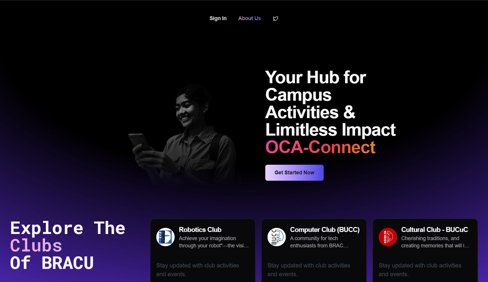
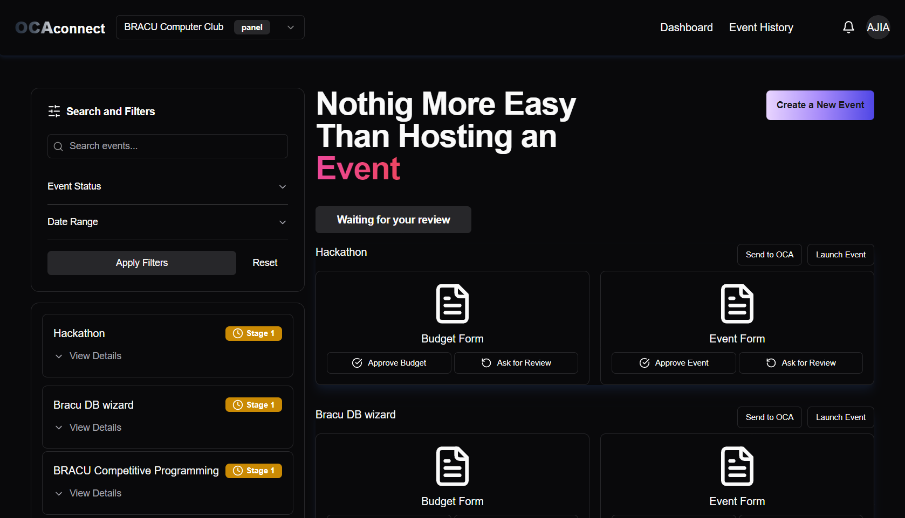
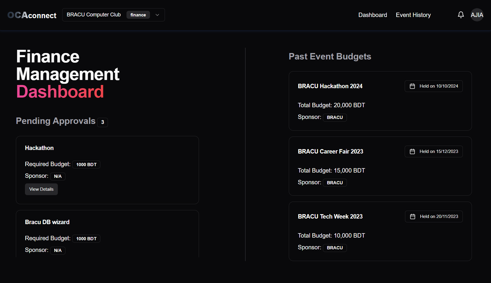
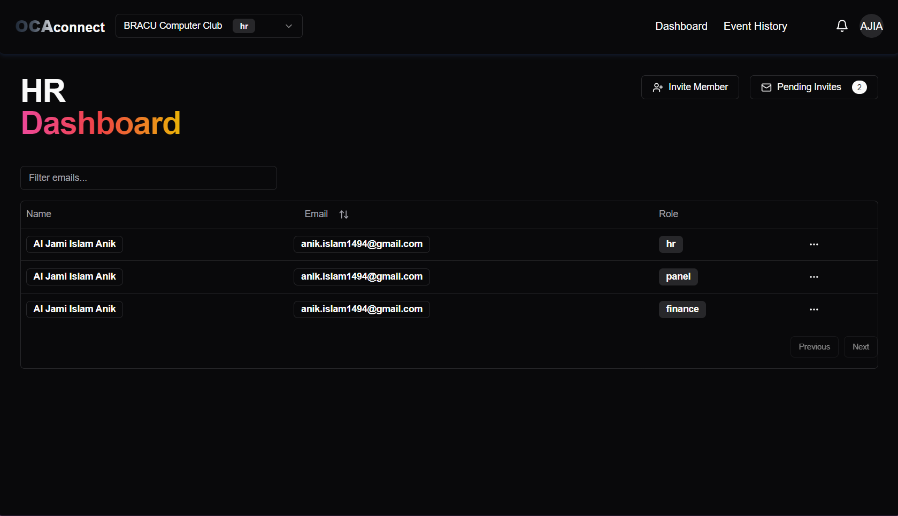

# Welcome to OCA Connect!

> [!IMPORTANT]
> OCA Connect is a platform for Club members and OCA members to communicate with each other.

## What we offer

- **Events**: Create and manage events, and view upcoming and past events.
- **Budgets**: Create and manage budgets for events, and view past event budgets.
- **Dedicated Dashboards**: A dedicated dashboard for each role of club members and OCA members to manage events and budgets.

  
  
  

## Tech stack

> [!NOTE]
> **Frontend**
> - Next.js
> - Tailwind CSS
> - Shadcn UI

> [!NOTE]
> **Backend**
> - Next.js API Routes

> [!NOTE]
> **Database**
> - Supabase
